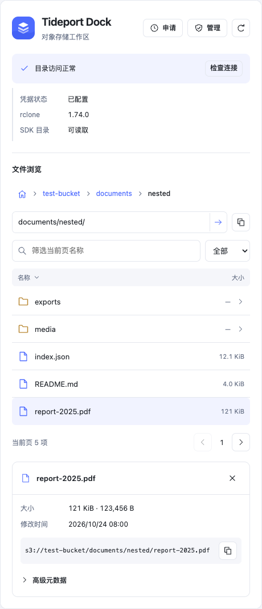
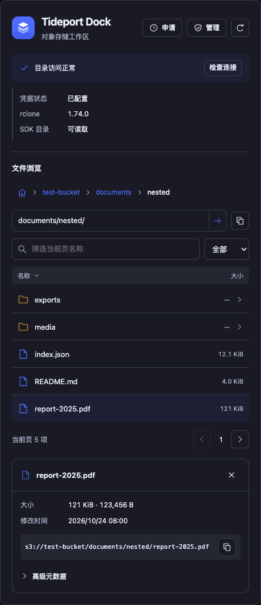
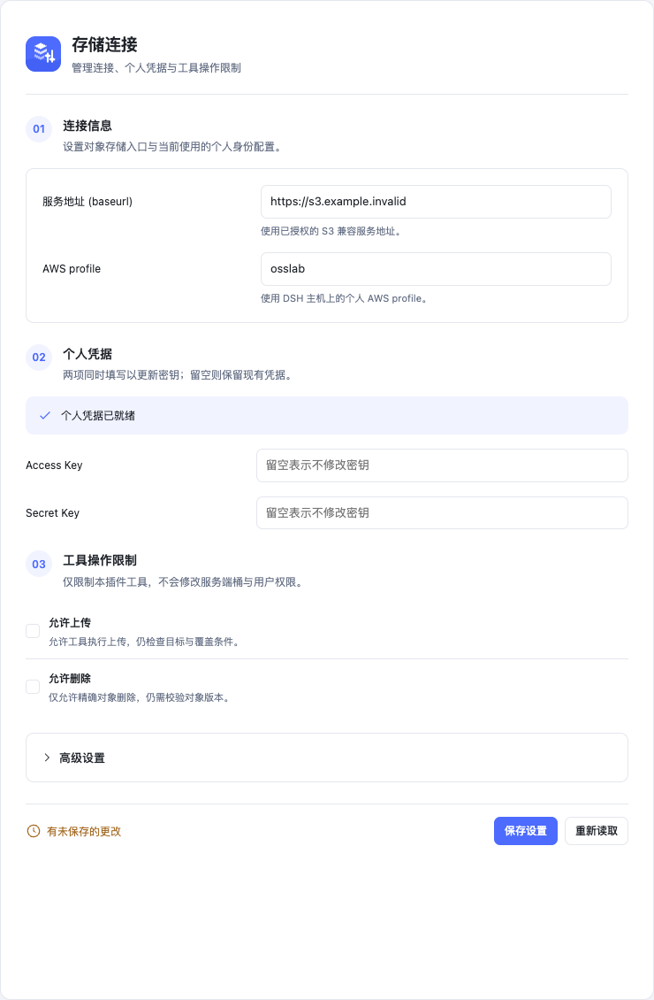

<div align="center">
  
  <h1>Tideport Dock · 潮港</h1>
  <p><strong>让对象存储，在你的工作区靠岸。</strong></p>
  <p>DeepSeek Harness 原生 OSS / S3 工作区</p>
  <p>
    <a href="https://github.com/Becomingw/Tideport-Dock/releases"></a>
    
    <a href="LICENSE"></a>
  </p>
  <p><a href="#快速开始">快速开始</a> · <a href="#界面预览">界面预览</a> · <a href="docs/configuration.md">配置指南</a> · <a href="docs/transfers.md">服务器传输</a> · <a href="https://github.com/Becomingw/Tideport-Dock/releases">下载</a></p>
</div>

---

**浏览文件、查看对象、管理连接、准备申请，再把传输交给 agent。** Tideport Dock 将日常对象存储操作接入 DSH，沿用你已有的个人 S3 身份与服务器访问方式。

| 文件，一目了然 | 操作，有据可查 | 服务器，直接连接 |
| :--- | :--- | :--- |
| 桶与多级前缀、分页浏览、名称筛选、对象详情 | 连接自检、操作预览、精确对象确认、版本检查 | 生成单文件传输脚本，配合 Orca 或已有远程工具执行 |

## 界面预览

<table>
  <tr><th>浅色 · 文件浏览</th><th>深色 · 文件浏览</th></tr>
  <tr>
    <td></td>
    <td></td>
  </tr>
</table>

<details>
  <summary><strong>展开查看连接与个人设置</strong></summary>
  <br />
  
</details>

<sub>截图来自真实插件界面的本地演示环境，使用示例文件和模拟连接状态。</sub>

## 快速开始

### 1. 安装

准备 **Node.js 22+** 和 **rclone**，然后获取源码：

```sh
git clone https://github.com/Becomingw/Tideport-Dock.git
cd Tideport-Dock
npm ci --ignore-scripts
npm test
```

也可从 [Releases](https://github.com/Becomingw/Tideport-Dock/releases) 下载 `.tgz`，使用同页的 `SHA256SUMS` 校验。解压后，在 `package/` 中运行 `npm install --ignore-scripts`。

### 2. 接入 DSH

在 DSH profile 的依赖中加入仓库或解压目录的**绝对路径**：

```json
{
  "dependencies": {
    "dsh-tideport-dock": "link:/absolute/path/to/Tideport-Dock"
  }
}
```

按 DSH 的包管理方式安装 profile 依赖，并参考 [cordis.patch.yml](cordis.patch.yml) 注册插件：

```yaml
- insert:
    - id: osslab
      name: dsh-tideport-dock
      config:
        endpoint: https://s3.example.invalid
        profile: osslab
        region: us-east-1
        allowedBuckets: [your-bucket]
        allowWrites: false
        allowDeletes: false
```

将示例地址与桶名替换为自己的配置后重启 DSH。若已有 `id: osslab`，直接更新该项，避免重复注册。

### 3. 连接存储

打开 **Tideport 设置**，配置 endpoint 与个人 AWS profile，再点击 **检查连接**。通过后即可浏览授权桶与文件。

凭据保存在执行主机的 `~/.aws/credentials`，设置页不会回显已有密钥。详细路径、TLS 与操作开关见 [配置指南](docs/configuration.md)。

## 与 agent 协作

可以直接描述目标和范围：

> 查看 `documents` 桶中 `reports/` 下的文件，给我这份 PDF 的对象详情。
>
> 为服务器上的 `/srv/export/report.zip` 准备上传计划，目标是 `archive` 桶的 `exports/report.zip`。
>
> 准备一份访问申请：需要读取 `documents` 桶的 `team/` 前缀。

| 操作 | 工具 |
| :--- | :--- |
| 检查连接与浏览 | `osslab_doctor` · `osslab_buckets` · `osslab_ls` · `osslab_stat` |
| 上传与下载 | `osslab_get` · `osslab_put` · `osslab_put_new` |
| 精确对象删除 | `osslab_delete` |
| 准备访问申请 | `osslab_request` |
| 服务器传输方案 | `osslab_transfer_recipe` |

本地路径属于工具实际运行的主机。服务器传输由远端进程直接访问 S3；操作步骤和校验方式见 [服务器传输指南](docs/transfers.md)。

## 申请与管理

申请中心默认采用「**填写 → 保存 → 交给管理员 → 配置与验收**」的流程，无需额外部署服务。管理工作区提供个人可见桶、草稿与申请入口。

多人在线审批可按需接入 [共享申请服务](docs/request-service.md)。申请、审批和实际交付分别记录；审批不会自动创建桶或授予 S3 权限。当前角色设置也不会提升服务端权限。

## 操作边界

- 上传、删除默认关闭；执行时还需满足各工具的显式确认条件。
- 删除针对精确对象，检查对象版本及写入状态，不提供递归删桶入口。
- 服务器脚本支持单文件传输：下载原子落盘且不覆盖；上传采用条件创建与回读 SHA-256 校验。
- 凭据留在个人 profile；脚本和仓库不携带密钥。TLS 默认使用系统信任或指定 CA。
- 实际权限始终由 S3 服务端核验。存储实现的条件写能力需在目标服务上验证。

## 致谢 · Thanks

感谢 **ruipeng** 的 [oss-lab-guide](http://192.168.8.67:3000/ruipeng/oss-lab-guide) 项目，为 Tideport Dock 的实验室对象存储接入提供了重要参考。项目中的使用指南、个人凭据约定、桶与权限申请流程，以及用户与管理员职责划分，帮助我们将存储操作融入 DSH 工作区。

<sub>上述项目链接需在实验室内网或连接相应 VPN 后访问。</sub>

## 开发与验证

```sh
npm test
node --check client.js

# 可选：服务器传输的离线测试，需在当前 Python 环境安装 boto3
python -m unittest discover -s test -p test_transfer.py -v
```

仓库包含工具与资源检查、传输计划、禁止覆盖、摘要校验和条件上传测试。浏览器回归覆盖深浅主题、窄屏、分页、设置与申请交互；安装后仍需验证实际 DSH 宿主与存储连接。

---

<div align="center">
  <strong>Tideport Dock</strong><br />
  <sub>对象存储，自然融入工作区。</sub><br />
  <a href="LICENSE">MIT License</a> · <a href="https://github.com/Becomingw/Tideport-Dock/issues">反馈问题</a>
</div>
